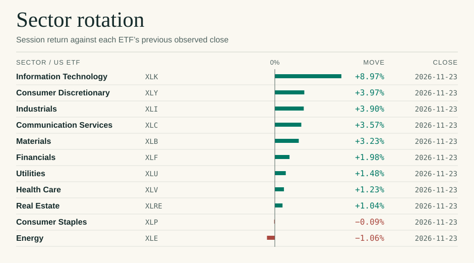

# Market Observatory

**[Open the live dashboard →](https://ankitv25.github.io/Market-Observatory/)**

[Full project plan](docs/PROJECT_PLAN.md) · [Research brief](docs/Market-Observatory-Research.pdf) · [Milestones](https://github.com/ankitv25/Market-Observatory/milestones)

**[Market tape](#market-tape) · [Sector rotation](#sector-rotation) · [Treasury curve](#treasury-curve) · [Research notebook](dashboard/RESEARCH.md) · [Cadence log](CADENCE.md) · [Work log](WORKLOG.md)**

Edition compiled **2026-11-28T07:08:12-05:00** · 62 market instruments · dated observations below. Prices and changes use each instrument’s own feed and session. Percentages use unrounded prices.

## The daily reading

**Market assessment:** risk-on · evidence agreement 83/100 · as of 2026-11-27. This score is not a forecast probability.

The US equity benchmark median returned +1.65%, against +2.18% for developed ex-US and emerging-market ETFs. VIX changed -15.84%. High-yield ETF prices outpaced short Treasuries by 0.14 pp.

[Assessment rules](docs/METHODOLOGY.md#market-intelligence-and-historical-story) · [Pipeline execution records](runs/)

**US equities.** The S&P 500 reached 7,297.49 on 2026-11-27, a move of +114.71 points (+1.60%) against 2026-11-25. Its six-month price change was -2.96% from 2026-05-27.

**Sector participation.** 11 of 11 reporting sector ETFs rose on 2026-11-27. Technology led at +2.80%; Utilities finished at +0.28%.

**Equity style.** On 2026-11-27 large-cap growth (+2.15%) finished 0.90 percentage points ahead of large-cap value (+1.25%), measured by IWF and IWD.

**Energy.** The Jan 2027 WTI contract closed at $83.08/bbl on 2026-11-27, -0.60 dollars per barrel against its own 2026-11-25 close.

**US rates.** On 2026-11-25 the 2-year par yield was 4.61% and the 10-year was 4.85%. The 2s10s spread stood at +24 bp, changing by -4 bp versus 2026-11-24.

**Macro backdrop.** The latest available MRS observation is 2026-10-31. Its regime is Neutral with a composite score of 0.166.

## Market tape

| Instrument | Last | Δ units | Δ % | 6 months | Observation |
|---|---:|---:|---:|---:|---|
|**Indices**||||||
|[S&P 500](https://finance.yahoo.com/quote/%5EGSPC/history/) · ^GSPC|7,297.49|+114.71|+1.60%|-2.96%|2026-11-27|
|[Nasdaq Composite](https://finance.yahoo.com/quote/%5EIXIC/history/) · ^IXIC|24,129.50|+543.70|+2.31%|-9.54%|2026-11-27|
|[Nasdaq 100](https://finance.yahoo.com/quote/%5ENDX/history/) · ^NDX|26,726.39|+679.49|+2.61%|-10.83%|2026-11-27|
|[Dow Industrials](https://finance.yahoo.com/quote/%5EDJI/history/) · ^DJI|50,774.94|+591.99|+1.18%|+0.26%|2026-11-27|
|[Russell 2000](https://finance.yahoo.com/quote/%5ERUT/history/) · ^RUT|2,750.30|+46.24|+1.71%|-5.81%|2026-11-27|
|**Sectors**||||||
|[Technology](https://finance.yahoo.com/quote/XLK/history/) · XLK|160.15|+4.36|+2.80%|-13.16%|2026-11-27|
|[Communication Services](https://finance.yahoo.com/quote/XLC/history/) · XLC|107.48|+2.10|+1.99%|-7.55%|2026-11-27|
|[Consumer Discretionary](https://finance.yahoo.com/quote/XLY/history/) · XLY|119.97|+2.48|+2.11%|-1.30%|2026-11-27|
|[Consumer Staples](https://finance.yahoo.com/quote/XLP/history/) · XLP|92.68|+0.38|+0.41%|+9.58%|2026-11-27|
|[Energy](https://finance.yahoo.com/quote/XLE/history/) · XLE|61.67|+0.77|+1.26%|+8.21%|2026-11-27|
|[Financials](https://finance.yahoo.com/quote/XLF/history/) · XLF|57.16|+0.65|+1.15%|+11.16%|2026-11-27|
|[Health Care](https://finance.yahoo.com/quote/XLV/history/) · XLV|184.20|+0.52|+0.28%|+23.80%|2026-11-27|
|[Industrials](https://finance.yahoo.com/quote/XLI/history/) · XLI|165.56|+2.61|+1.60%|-5.01%|2026-11-27|
|[Materials](https://finance.yahoo.com/quote/XLB/history/) · XLB|52.15|+0.94|+1.84%|+1.90%|2026-11-27|
|[Real Estate](https://finance.yahoo.com/quote/XLRE/history/) · XLRE|44.14|+0.28|+0.64%|-1.10%|2026-11-27|
|[Utilities](https://finance.yahoo.com/quote/XLU/history/) · XLU|43.73|+0.12|+0.28%|-3.12%|2026-11-27|
|**Styles**||||||
|[US large cap](https://finance.yahoo.com/quote/SPY/history/) · SPY|728.32|+11.62|+1.62%|-2.95%|2026-11-27|
|[Equal-weight S&P 500](https://finance.yahoo.com/quote/RSP/history/) · RSP|218.38|+2.64|+1.22%|+5.25%|2026-11-27|
|[US large-cap growth](https://finance.yahoo.com/quote/IWF/history/) · IWF|109.31|+2.30|+2.15%|-13.05%|2026-11-27|
|[US large-cap value](https://finance.yahoo.com/quote/IWD/history/) · IWD|257.96|+3.18|+1.25%|+8.42%|2026-11-27|
|[US small cap](https://finance.yahoo.com/quote/IWM/history/) · IWM|273.79|+4.92|+1.83%|-5.71%|2026-11-27|
|[US momentum](https://finance.yahoo.com/quote/MTUM/history/) · MTUM|63.38|+1.87|+3.04%|-19.09%|2026-11-27|
|[US quality](https://finance.yahoo.com/quote/QUAL/history/) · QUAL|54.67|+0.64|+1.18%|+1.60%|2026-11-27|
|**Global**||||||
|[Euro STOXX 50](https://finance.yahoo.com/quote/%5ESTOXX50E/history/) · ^STOXX50E|6,089.20|+74.46|+1.24%|+0.31%|2026-11-27|
|[FTSE 100](https://finance.yahoo.com/quote/%5EFTSE/history/) · ^FTSE|10,698.80|+89.50|+0.84%|+1.84%|2026-11-27|
|[Nikkei 225](https://finance.yahoo.com/quote/%5EN225/history/) · ^N225|58,711.11|+1,211.95|+2.11%|-9.67%|2026-11-27|
|[Hang Seng](https://finance.yahoo.com/quote/%5EHSI/history/) · ^HSI|22,694.77|+467.89|+2.11%|-10.40%|2026-11-27|
|[Nifty 50](https://finance.yahoo.com/quote/%5ENSEI/history/) · ^NSEI|25,607.20|-277.30|-1.07%|+7.11%|2026-11-27|
|[S&P/TSX Composite](https://finance.yahoo.com/quote/%5EGSPTSE/history/) · ^GSPTSE|34,839.90|+413.00|+1.20%|+1.24%|2026-11-27|
|[All-country equity](https://finance.yahoo.com/quote/ACWI/history/) · ACWI|150.58|+2.58|+1.74%|-4.48%|2026-11-27|
|[Developed ex-US/Canada](https://finance.yahoo.com/quote/EFA/history/) · EFA|100.52|+1.34|+1.35%|-4.06%|2026-11-27|
|[Emerging markets](https://finance.yahoo.com/quote/EEM/history/) · EEM|58.10|+1.70|+3.01%|-15.05%|2026-11-27|
|**Futures**||||||
|[WTI crude](https://finance.yahoo.com/quote/CLF27.NYM/history/) · CLF27.NYM|83.08|-0.60|-0.72%|+8.15%|2026-11-27|
|[Brent crude](https://finance.yahoo.com/quote/BZF27.NYM/history/) · BZF27.NYM|95.44|+0.83|+0.88%|+14.90%|2026-11-27|
|[Natural gas](https://finance.yahoo.com/quote/NGF27.NYM/history/) · NGF27.NYM|3.49|-0.17|-4.57%|-19.67%|2026-11-27|
|[Gold](https://finance.yahoo.com/quote/GCZ26.CMX/history/) · GCZ26.CMX|3,639.60|+103.80|+2.94%|-19.92%|2026-11-27|
|[Silver](https://finance.yahoo.com/quote/SIZ26.CMX/history/) · SIZ26.CMX|43.17|+3.11|+7.76%|-43.41%|2026-11-27|
|[Copper](https://finance.yahoo.com/quote/HGH27.CMX/history/) · HGH27.CMX|5.60|+0.18|+3.30%|-14.85%|2026-11-27|
|[Corn](https://finance.yahoo.com/quote/ZCH27.CBT/history/) · ZCH27.CBT|463.00|+6.50|+1.42%|-5.94%|2026-11-27|
|[S&P 500 E-mini](https://finance.yahoo.com/quote/ESZ26.CME/history/) · ESZ26.CME|7,308.25|+112.50|+1.56%|-4.65%|2026-11-27|
|[10Y Treasury note](https://finance.yahoo.com/quote/ZNZ26.CBT/history/) · ZNZ26.CBT|106.66|-0.53|-0.50%|-2.68%|2026-11-27|
|**FX**||||||
|[US Dollar Index](https://finance.yahoo.com/quote/DX-Y.NYB/history/) · DX-Y.NYB|104.0100|+0.3400|+0.33%|+4.84%|2026-11-27|
|[EUR/USD](https://finance.yahoo.com/quote/EURUSD%3DX/history/) · EURUSD=X|1.0972|+0.0002|+0.02%|-5.71%|2026-11-27|
|[USD/JPY](https://finance.yahoo.com/quote/JPY%3DX/history/) · JPY=X|159.2810|+0.0660|+0.04%|+0.02%|2026-11-27|
|[GBP/USD](https://finance.yahoo.com/quote/GBPUSD%3DX/history/) · GBPUSD=X|1.3107|-0.0006|-0.04%|-2.59%|2026-11-27|
|[USD/CHF](https://finance.yahoo.com/quote/CHF%3DX/history/) · CHF=X|0.8345|+0.0033|+0.40%|+6.29%|2026-11-27|
|**Credit**||||||
|[Short Treasuries](https://finance.yahoo.com/quote/SHY/history/) · SHY|81.62|-0.02|-0.02%|-0.73%|2026-11-27|
|[Intermediate Treasuries](https://finance.yahoo.com/quote/IEF/history/) · IEF|91.66|-0.40|-0.43%|-2.82%|2026-11-27|
|[Long Treasuries](https://finance.yahoo.com/quote/TLT/history/) · TLT|81.27|-0.97|-1.18%|-4.72%|2026-11-27|
|[Inflation-linked Treasuries](https://finance.yahoo.com/quote/TIP/history/) · TIP|105.67|-0.17|-0.16%|-4.70%|2026-11-27|
|[Investment-grade credit](https://finance.yahoo.com/quote/LQD/history/) · LQD|104.00|-0.29|-0.28%|-4.53%|2026-11-27|
|[High-yield credit](https://finance.yahoo.com/quote/HYG/history/) · HYG|76.61|+0.09|+0.12%|-4.39%|2026-11-27|
|[Agency mortgages](https://finance.yahoo.com/quote/MBB/history/) · MBB|91.77|-0.26|-0.28%|-2.77%|2026-11-27|
|[Municipal bonds](https://finance.yahoo.com/quote/MUB/history/) · MUB|103.95|-0.24|-0.23%|-2.75%|2026-11-27|
|[EM dollar debt](https://finance.yahoo.com/quote/EMB/history/) · EMB|91.14|+0.41|+0.45%|-5.04%|2026-11-27|
|[Senior loans](https://finance.yahoo.com/quote/BKLN/history/) · BKLN|20.43|+0.04|+0.20%|-0.34%|2026-11-27|
|**Alternatives**||||||
|[Listed real estate](https://finance.yahoo.com/quote/VNQ/history/) · VNQ|96.24|+0.58|+0.61%|-0.70%|2026-11-27|
|[Listed infrastructure](https://finance.yahoo.com/quote/IGF/history/) · IGF|66.00|+0.29|+0.44%|-1.70%|2026-11-27|
|[Managed futures](https://finance.yahoo.com/quote/DBMF/history/) · DBMF|31.66|+0.15|+0.48%|+2.10%|2026-11-27|
|[Physical gold ETF](https://finance.yahoo.com/quote/GLD/history/) · GLD|334.40|+6.95|+2.12%|-18.14%|2026-11-27|
|[Bitcoin](https://finance.yahoo.com/quote/BTC-USD/history/) · BTC-USD|59,866.37|-628.34|-1.04%|-19.47%|2026-11-27|
|[Cboe VIX](https://finance.yahoo.com/quote/%5EVIX/history/) · ^VIX|23.81|-2.99|-11.16%|+46.16%|2026-11-27|

## Sector rotation

## Treasury curve

[US Treasury par yields](https://www.federalreserve.gov/datadownload/Output.aspx?rel=H15&series=bf17364827e38702b42a58cf8eaa3f78&lastobs=300&from=&to=&filetype=csv&label=include&layout=seriescolumn) · 2026-11-25 versus 2026-11-24.

| Maturity | Yield | Δ bp |
|---|---:|---:|
|1M|4.27%|+6|
|3M|4.34%|-2|
|6M|4.44%|-2|
|1Y|4.56%|-3|
|2Y|4.61%|-2|
|3Y|4.64%|-3|
|5Y|4.65%|-4|
|7Y|4.74%|-5|
|10Y|4.85%|-6|
|20Y|5.28%|-5|
|30Y|5.24%|-6|

## Edition record

[Quality and source notes](dashboard/SOURCES.md) · [Archived editions](editions/) · [Refresh runs](https://github.com/ankitv25/Market-Observatory/actions/workflows/refresh.yml) · [Methodology](docs/METHODOLOGY.md)

For interactive charts, filters and source detail, download [the self-contained HTML reader](dashboard/observatory.html) using GitHub’s **Download raw file** button and open it locally. Each refresh run also provides the reader as an artifact.
