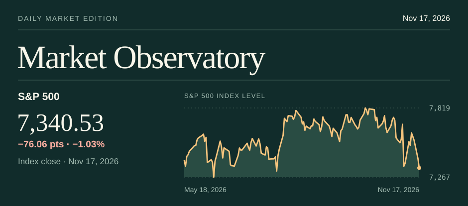

# Market Observatory

**[Open the live dashboard →](https://ankitv25.github.io/Market-Observatory/)**

[Full project plan](docs/PROJECT_PLAN.md) · [Research brief](docs/Market-Observatory-Research.pdf) · [Milestones](https://github.com/ankitv25/Market-Observatory/milestones)

**[Market tape](#market-tape) · [Sector rotation](#sector-rotation) · [Treasury curve](#treasury-curve) · [Research notebook](dashboard/RESEARCH.md) · [Cadence log](CADENCE.md) · [Work log](WORKLOG.md)**

Edition compiled **2026-11-25T21:19:56-05:00** · 62 market instruments · dated observations below. Prices and changes use each instrument’s own feed and session. Percentages use unrounded prices.

## The daily reading

**Market assessment:** mixed · evidence agreement 33/100 · as of 2026-11-25. This score is not a forecast probability.

The US equity benchmark median returned +0.23%, against -0.10% for developed ex-US and emerging-market ETFs. VIX changed +7.32%. High-yield ETF prices outpaced short Treasuries by 0.03 pp. The counterweight is equity volatility.

[Assessment rules](docs/METHODOLOGY.md#market-intelligence-and-historical-story) · [Pipeline execution records](runs/)

**Source status.** Awaiting a new source response for Technology, Communication Services, Consumer Discretionary, Consumer Staples, Energy, Financials, Health Care, Industrials, Materials, Real Estate, Utilities, US large cap, Equal-weight S&P 500, US large-cap growth, US large-cap value, US small cap, US momentum, US quality, Euro STOXX 50, FTSE 100, Nikkei 225, Hang Seng, Nifty 50, All-country equity, Developed ex-US/Canada, Emerging markets, Short Treasuries, Intermediate Treasuries, Long Treasuries, Inflation-linked Treasuries, Investment-grade credit, High-yield credit, Agency mortgages, Municipal bonds, EM dollar debt, Senior loans, Listed real estate, Listed infrastructure, Managed futures, Physical gold ETF

**US equities.** The S&P 500 reached 7,182.78 on 2026-11-25, a move of -18.31 points (-0.25%) against 2026-11-24. Its six-month price change was -3.89% from 2026-05-22.

**Sector participation.** 8 of 11 reporting sector ETFs rose on 2026-11-25. Materials led at +2.07%; Technology finished at -0.83%.

**Equity style.** On 2026-11-25 large-cap growth (-0.82%) finished 1.14 percentage points behind large-cap value (+0.33%), measured by IWF and IWD.

**Energy.** The Jan 2027 WTI contract closed at $82.05/bbl on 2026-11-24, +1.88 dollars per barrel against its own 2026-11-23 close.

**US rates.** On 2026-11-24 the 2-year par yield was 4.63% and the 10-year was 4.91%. The 2s10s spread stood at +28 bp, changing by -1 bp versus 2026-11-23.

**Macro backdrop.** The latest available MRS observation is 2026-10-31. Its regime is Neutral with a composite score of 0.166.

## Market tape

| Instrument | Last | Δ units | Δ % | 6 months | Observation |
|---|---:|---:|---:|---:|---|
|**Indices**||||||
|[S&P 500](https://finance.yahoo.com/quote/%5EGSPC/history/) · ^GSPC|7,182.78|-18.31|-0.25%|-3.89%|2026-11-25|
|[Nasdaq Composite](https://finance.yahoo.com/quote/%5EIXIC/history/) · ^IXIC|23,585.80|-147.74|-0.62%|-10.47%|2026-11-25|
|[Nasdaq 100](https://finance.yahoo.com/quote/%5ENDX/history/) · ^NDX|26,046.90|-167.27|-0.64%|-11.65%|2026-11-25|
|[Dow Industrials](https://finance.yahoo.com/quote/%5EDJI/history/) · ^DJI|50,182.95|+164.25|+0.33%|-0.78%|2026-11-25|
|[Russell 2000](https://finance.yahoo.com/quote/%5ERUT/history/) · ^RUT|2,704.06|+19.12|+0.71%|-5.76%|2026-11-25|
|**Sectors**||||||
|[Technology](https://finance.yahoo.com/quote/XLK/history/) · XLK|155.79|-1.30|-0.83%|-13.64%|2026-11-25|
|[Communication Services](https://finance.yahoo.com/quote/XLC/history/) · XLC|105.38|+0.93|+0.89%|-8.73%|2026-11-25|
|[Consumer Discretionary](https://finance.yahoo.com/quote/XLY/history/) · XLY|117.49|-0.23|-0.20%|-1.42%|2026-11-25|
|[Consumer Staples](https://finance.yahoo.com/quote/XLP/history/) · XLP|92.30|+0.42|+0.46%|+8.84%|2026-11-25|
|[Energy](https://finance.yahoo.com/quote/XLE/history/) · XLE|60.90|+0.45|+0.74%|+2.37%|2026-11-25|
|[Financials](https://finance.yahoo.com/quote/XLF/history/) · XLF|56.51|+0.40|+0.71%|+8.80%|2026-11-25|
|[Health Care](https://finance.yahoo.com/quote/XLV/history/) · XLV|183.68|-1.04|-0.56%|+22.54%|2026-11-25|
|[Industrials](https://finance.yahoo.com/quote/XLI/history/) · XLI|162.95|+1.34|+0.83%|-5.13%|2026-11-25|
|[Materials](https://finance.yahoo.com/quote/XLB/history/) · XLB|51.21|+1.04|+2.07%|+1.83%|2026-11-25|
|[Real Estate](https://finance.yahoo.com/quote/XLRE/history/) · XLRE|43.86|+0.40|+0.92%|-1.57%|2026-11-25|
|[Utilities](https://finance.yahoo.com/quote/XLU/history/) · XLU|43.61|+0.21|+0.48%|-3.84%|2026-11-25|
|**Styles**||||||
|[US large cap](https://finance.yahoo.com/quote/SPY/history/) · SPY|716.70|-2.08|-0.29%|-3.88%|2026-11-25|
|[Equal-weight S&P 500](https://finance.yahoo.com/quote/RSP/history/) · RSP|215.74|+1.78|+0.83%|+4.43%|2026-11-25|
|[US large-cap growth](https://finance.yahoo.com/quote/IWF/history/) · IWF|107.01|-0.88|-0.82%|-14.39%|2026-11-25|
|[US large-cap value](https://finance.yahoo.com/quote/IWD/history/) · IWD|254.78|+0.83|+0.33%|+7.81%|2026-11-25|
|[US small cap](https://finance.yahoo.com/quote/IWM/history/) · IWM|268.87|+1.73|+0.65%|-5.70%|2026-11-25|
|[US momentum](https://finance.yahoo.com/quote/MTUM/history/) · MTUM|61.51|-0.38|-0.61%|-18.96%|2026-11-25|
|[US quality](https://finance.yahoo.com/quote/QUAL/history/) · QUAL|54.03|-0.03|-0.06%|+0.81%|2026-11-25|
|**Global**||||||
|[Euro STOXX 50](https://finance.yahoo.com/quote/%5ESTOXX50E/history/) · ^STOXX50E|5,894.46|-109.30|-1.82%|-2.08%|2026-11-25|
|[FTSE 100](https://finance.yahoo.com/quote/%5EFTSE/history/) · ^FTSE|10,426.94|-40.16|-0.38%|-0.38%|2026-11-25|
|[Nikkei 225](https://finance.yahoo.com/quote/%5EN225/history/) · ^N225|57,011.62|-1,633.01|-2.78%|-12.50%|2026-11-25|
|[Hang Seng](https://finance.yahoo.com/quote/%5EHSI/history/) · ^HSI|21,966.01|-253.64|-1.14%|-14.22%|2026-11-25|
|[Nifty 50](https://finance.yahoo.com/quote/%5ENSEI/history/) · ^NSEI|25,819.25|+469.60|+1.85%|+7.44%|2026-11-25|
|[S&P/TSX Composite](https://finance.yahoo.com/quote/%5EGSPTSE/history/) · ^GSPTSE|34,179.99|+217.69|+0.64%|-1.57%|2026-11-25|
|[All-country equity](https://finance.yahoo.com/quote/ACWI/history/) · ACWI|148.00|-0.14|-0.09%|-5.12%|2026-11-25|
|[Developed ex-US/Canada](https://finance.yahoo.com/quote/EFA/history/) · EFA|99.18|+0.30|+0.30%|-4.62%|2026-11-25|
|[Emerging markets](https://finance.yahoo.com/quote/EEM/history/) · EEM|56.40|-0.29|-0.51%|-14.39%|2026-11-25|
|**Futures**||||||
|[WTI crude](https://finance.yahoo.com/quote/CLF27.NYM/history/) · CLF27.NYM|82.05|+1.88|+2.35%|+3.01%|2026-11-24|
|[Brent crude](https://finance.yahoo.com/quote/BZF27.NYM/history/) · BZF27.NYM|91.40|+2.03|+2.27%|+5.81%|2026-11-24|
|[Natural gas](https://finance.yahoo.com/quote/NGF27.NYM/history/) · NGF27.NYM|3.66|+0.14|+3.97%|-16.71%|2026-11-24|
|[Gold](https://finance.yahoo.com/quote/GCZ26.CMX/history/) · GCZ26.CMX|3,561.90|-89.50|-2.45%|-22.96%|2026-11-24|
|[Silver](https://finance.yahoo.com/quote/SIZ26.CMX/history/) · SIZ26.CMX|40.78|-2.39|-5.54%|-47.44%|2026-11-24|
|[Copper](https://finance.yahoo.com/quote/HGH27.CMX/history/) · HGH27.CMX|5.45|-0.27|-4.70%|-17.62%|2026-11-24|
|[Corn](https://finance.yahoo.com/quote/ZCH27.CBT/history/) · ZCH27.CBT|450.25|+0.50|+0.11%|-10.08%|2026-11-24|
|[S&P 500 E-mini](https://finance.yahoo.com/quote/ESZ26.CME/history/) · ESZ26.CME|7,217.50|-37.00|-0.51%|-5.21%|2026-11-24|
|[10Y Treasury note](https://finance.yahoo.com/quote/ZNZ26.CBT/history/) · ZNZ26.CBT|106.86|+0.11|+0.10%|-1.85%|2026-11-24|
|**FX**||||||
|[US Dollar Index](https://finance.yahoo.com/quote/DX-Y.NYB/history/) · DX-Y.NYB|103.8100|-0.5100|-0.49%|+4.52%|2026-11-24|
|[EUR/USD](https://finance.yahoo.com/quote/EURUSD%3DX/history/) · EURUSD=X|1.0962|+0.0054|+0.50%|-5.84%|2026-11-25|
|[USD/JPY](https://finance.yahoo.com/quote/JPY%3DX/history/) · JPY=X|159.2620|+0.2530|+0.16%|+0.20%|2026-11-25|
|[GBP/USD](https://finance.yahoo.com/quote/GBPUSD%3DX/history/) · GBPUSD=X|1.3112|+0.0077|+0.59%|-2.74%|2026-11-25|
|[USD/CHF](https://finance.yahoo.com/quote/CHF%3DX/history/) · CHF=X|0.8358|-0.0057|-0.68%|+6.84%|2026-11-25|
|**Credit**||||||
|[Short Treasuries](https://finance.yahoo.com/quote/SHY/history/) · SHY|81.64|+0.07|+0.09%|-0.58%|2026-11-25|
|[Intermediate Treasuries](https://finance.yahoo.com/quote/IEF/history/) · IEF|92.06|+0.42|+0.46%|-1.94%|2026-11-25|
|[Long Treasuries](https://finance.yahoo.com/quote/TLT/history/) · TLT|82.24|+0.75|+0.92%|-2.88%|2026-11-25|
|[Inflation-linked Treasuries](https://finance.yahoo.com/quote/TIP/history/) · TIP|105.84|+0.39|+0.37%|-4.11%|2026-11-25|
|[Investment-grade credit](https://finance.yahoo.com/quote/LQD/history/) · LQD|104.29|+0.50|+0.48%|-3.76%|2026-11-25|
|[High-yield credit](https://finance.yahoo.com/quote/HYG/history/) · HYG|76.52|+0.09|+0.12%|-4.24%|2026-11-25|
|[Agency mortgages](https://finance.yahoo.com/quote/MBB/history/) · MBB|92.03|+0.36|+0.39%|-2.18%|2026-11-25|
|[Municipal bonds](https://finance.yahoo.com/quote/MUB/history/) · MUB|104.19|+0.42|+0.40%|-1.86%|2026-11-25|
|[EM dollar debt](https://finance.yahoo.com/quote/EMB/history/) · EMB|90.73|+0.34|+0.38%|-4.67%|2026-11-25|
|[Senior loans](https://finance.yahoo.com/quote/BKLN/history/) · BKLN|20.39|-0.04|-0.20%|-0.39%|2026-11-25|
|**Alternatives**||||||
|[Listed real estate](https://finance.yahoo.com/quote/VNQ/history/) · VNQ|95.66|+0.88|+0.93%|-1.15%|2026-11-25|
|[Listed infrastructure](https://finance.yahoo.com/quote/IGF/history/) · IGF|65.71|+0.54|+0.83%|-2.51%|2026-11-25|
|[Managed futures](https://finance.yahoo.com/quote/DBMF/history/) · DBMF|31.51|-0.07|-0.22%|+1.35%|2026-11-25|
|[Physical gold ETF](https://finance.yahoo.com/quote/GLD/history/) · GLD|327.45|+2.00|+0.61%|-20.87%|2026-11-25|
|[Bitcoin](https://finance.yahoo.com/quote/BTC-USD/history/) · BTC-USD|59,747.77|-1,463.22|-2.39%|-22.39%|2026-11-24|
|[Cboe VIX](https://finance.yahoo.com/quote/%5EVIX/history/) · ^VIX|28.29|+1.93|+7.32%|+70.52%|2026-11-25|

## Sector rotation

## Treasury curve

[US Treasury par yields](https://www.federalreserve.gov/datadownload/Output.aspx?rel=H15&series=bf17364827e38702b42a58cf8eaa3f78&lastobs=300&from=&to=&filetype=csv&label=include&layout=seriescolumn) · 2026-11-24 versus 2026-11-23.

| Maturity | Yield | Δ bp |
|---|---:|---:|
|1M|4.21%|+1|
|3M|4.36%|-1|
|6M|4.46%|+1|
|1Y|4.59%|+2|
|2Y|4.63%|+0|
|3Y|4.67%|-2|
|5Y|4.69%|-5|
|7Y|4.79%|-2|
|10Y|4.91%|-1|
|20Y|5.33%|+0|
|30Y|5.30%|+1|

## Edition record

[Quality and source notes](dashboard/SOURCES.md) · [Archived editions](editions/) · [Refresh runs](https://github.com/ankitv25/Market-Observatory/actions/workflows/refresh.yml) · [Methodology](docs/METHODOLOGY.md)

For interactive charts, filters and source detail, download [the self-contained HTML reader](dashboard/observatory.html) using GitHub’s **Download raw file** button and open it locally. Each refresh run also provides the reader as an artifact.
