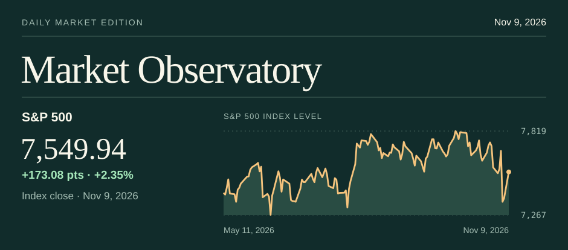
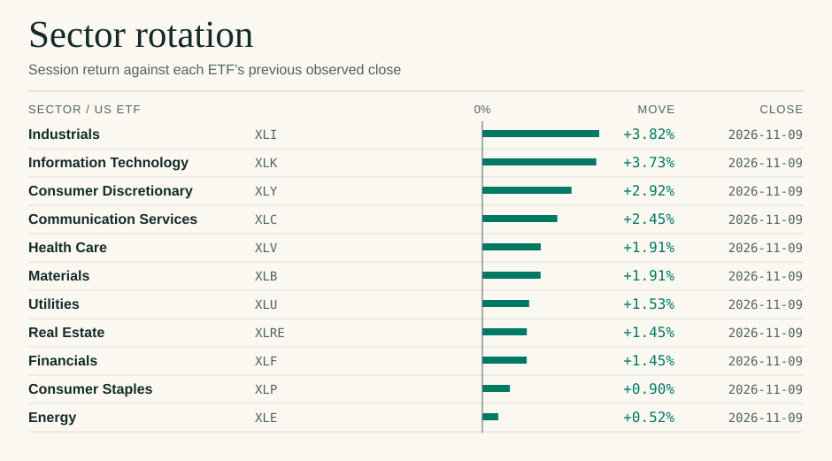
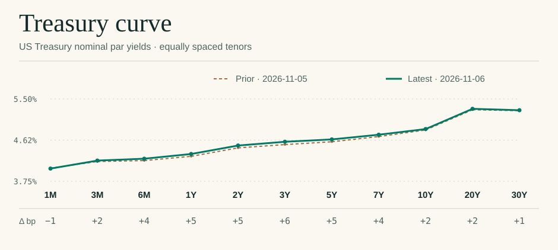

# Market Observatory

**[Market tape](#market-tape) · [Sector rotation](#sector-rotation) · [Treasury curve](#treasury-curve) · [Research notebook](dashboard/RESEARCH.md) · [Cadence log](CADENCE.md) · [Work log](WORKLOG.md)**

Edition compiled **2026-11-07T16:41:57-05:00** · 62 market instruments · dated observations below. Prices and changes use each instrument’s own feed and session. Percentages use unrounded prices.

## The daily reading

**US equities.** The S&P 500 reached 7,376.86 on 2026-11-06, a move of +23.13 points (+0.31%) against 2026-11-05. Its six-month price change was +0.16% from 2026-05-06.

**Sector participation.** 3 of 11 reporting sector ETFs rose on 2026-11-06. Technology led at +1.45%; Consumer Staples finished at -1.28%.

**US rates.** On 2026-11-05 the 2-year par yield was 4.46% and the 10-year was 4.84%. The 2s10s spread stood at +38 bp, changing by +6 bp versus 2026-11-04.

**Macro backdrop.** The latest available MRS observation is 2026-09-30. Its regime is Neutral with a composite score of 0.2537.

## Market tape

| Instrument | Last | Δ units | Δ % | 6 months | Observation |
|---|---:|---:|---:|---:|---|
|**Indices**||||||
|[S&P 500](https://finance.yahoo.com/quote/%5EGSPC/history/) · ^GSPC|7,376.86|+23.13|+0.31%|+0.16%|2026-11-06|
|[Nasdaq Composite](https://finance.yahoo.com/quote/%5EIXIC/history/) · ^IXIC|24,579.43|+264.43|+1.09%|-4.87%|2026-11-06|
|[Nasdaq 100](https://finance.yahoo.com/quote/%5ENDX/history/) · ^NDX|26,989.99|+360.18|+1.35%|-5.63%|2026-11-06|
|[Dow Industrials](https://finance.yahoo.com/quote/%5EDJI/history/) · ^DJI|51,285.73|-237.33|-0.46%|+2.76%|2026-11-06|
|[Russell 2000](https://finance.yahoo.com/quote/%5ERUT/history/) · ^RUT|2,754.11|+24.22|+0.89%|-4.60%|2026-11-06|
|**Sectors**||||||
|[Technology](https://finance.yahoo.com/quote/XLK/history/) · XLK|164.74|+2.36|+1.45%|-3.11%|2026-11-06|
|[Communication Services](https://finance.yahoo.com/quote/XLC/history/) · XLC|104.79|+0.45|+0.43%|-10.70%|2026-11-06|
|[Consumer Discretionary](https://finance.yahoo.com/quote/XLY/history/) · XLY|117.58|-0.06|-0.05%|-1.91%|2026-11-06|
|[Consumer Staples](https://finance.yahoo.com/quote/XLP/history/) · XLP|90.08|-1.17|-1.28%|+6.93%|2026-11-06|
|[Energy](https://finance.yahoo.com/quote/XLE/history/) · XLE|61.62|-0.01|-0.02%|+8.11%|2026-11-06|
|[Financials](https://finance.yahoo.com/quote/XLF/history/) · XLF|57.16|-0.34|-0.59%|+10.26%|2026-11-06|
|[Health Care](https://finance.yahoo.com/quote/XLV/history/) · XLV|184.80|-0.11|-0.06%|+27.10%|2026-11-06|
|[Industrials](https://finance.yahoo.com/quote/XLI/history/) · XLI|162.67|+0.20|+0.12%|-8.03%|2026-11-06|
|[Materials](https://finance.yahoo.com/quote/XLB/history/) · XLB|51.95|-0.38|-0.73%|-0.88%|2026-11-06|
|[Real Estate](https://finance.yahoo.com/quote/XLRE/history/) · XLRE|44.00|-0.30|-0.68%|-1.65%|2026-11-06|
|[Utilities](https://finance.yahoo.com/quote/XLU/history/) · XLU|43.13|-0.17|-0.39%|-5.64%|2026-11-06|
|**Styles**||||||
|[US large cap](https://finance.yahoo.com/quote/SPY/history/) · SPY|735.29|+2.29|+0.31%|+0.20%|2026-11-06|
|[Equal-weight S&P 500](https://finance.yahoo.com/quote/RSP/history/) · RSP|216.05|-0.82|-0.38%|+5.47%|2026-11-06|
|[US large-cap growth](https://finance.yahoo.com/quote/IWF/history/) · IWF|111.75|+1.39|+1.26%|-8.73%|2026-11-06|
|[US large-cap value](https://finance.yahoo.com/quote/IWD/history/) · IWD|257.45|-0.93|-0.36%|+9.80%|2026-11-06|
|[US small cap](https://finance.yahoo.com/quote/IWM/history/) · IWM|273.67|+2.69|+0.99%|-4.58%|2026-11-06|
|[US momentum](https://finance.yahoo.com/quote/MTUM/history/) · MTUM|63.76|+1.16|+1.85%|-14.75%|2026-11-06|
|[US quality](https://finance.yahoo.com/quote/QUAL/history/) · QUAL|54.83|+0.04|+0.07%|+4.42%|2026-11-06|
|**Global**||||||
|[Euro STOXX 50](https://finance.yahoo.com/quote/%5ESTOXX50E/history/) · ^STOXX50E|6,170.49|-61.05|-0.98%|+2.38%|2026-11-06|
|[FTSE 100](https://finance.yahoo.com/quote/%5EFTSE/history/) · ^FTSE|10,673.90|-108.80|-1.01%|+2.25%|2026-11-06|
|[Nikkei 225](https://finance.yahoo.com/quote/%5EN225/history/) · ^N225|57,434.77|-3,643.13|-5.96%|-3.49%|2026-11-06|
|[Hang Seng](https://finance.yahoo.com/quote/%5EHSI/history/) · ^HSI|24,481.86|-315.12|-1.27%|-6.61%|2026-11-06|
|[Nifty 50](https://finance.yahoo.com/quote/%5ENSEI/history/) · ^NSEI|25,030.35|+493.75|+2.01%|+2.87%|2026-11-06|
|[S&P/TSX Composite](https://finance.yahoo.com/quote/%5EGSPTSE/history/) · ^GSPTSE|35,789.10|+183.80|+0.52%|+5.32%|2026-11-06|
|[All-country equity](https://finance.yahoo.com/quote/ACWI/history/) · ACWI|152.37|-0.06|-0.04%|-1.95%|2026-11-06|
|[Developed ex-US/Canada](https://finance.yahoo.com/quote/EFA/history/) · EFA|101.89|-0.81|-0.79%|-2.79%|2026-11-06|
|[Emerging markets](https://finance.yahoo.com/quote/EEM/history/) · EEM|59.33|+1.28|+2.21%|-12.09%|2026-11-06|
|**Futures**||||||
|[WTI crude](https://finance.yahoo.com/quote/CLZ26.NYM/history/) · CLZ26.NYM|90.83|+0.31|+0.34%|+17.85%|2026-11-06|
|[Brent crude](https://finance.yahoo.com/quote/BZF27.NYM/history/) · BZF27.NYM|98.32|+0.03|+0.03%|+18.06%|2026-11-06|
|[Natural gas](https://finance.yahoo.com/quote/NGZ26.NYM/history/) · NGZ26.NYM|3.00|+0.05|+1.73%|-28.45%|2026-11-06|
|[Gold](https://finance.yahoo.com/quote/GCZ26.CMX/history/) · GCZ26.CMX|4,074.90|-38.60|-0.94%|-15.07%|2026-11-06|
|[Silver](https://finance.yahoo.com/quote/SIZ26.CMX/history/) · SIZ26.CMX|51.94|-0.43|-0.83%|-33.98%|2026-11-06|
|[Copper](https://finance.yahoo.com/quote/HGZ26.CMX/history/) · HGZ26.CMX|6.24|-0.03|-0.52%|-1.49%|2026-11-06|
|[Corn](https://finance.yahoo.com/quote/ZCZ26.CBT/history/) · ZCZ26.CBT|441.50|+1.50|+0.34%|-9.90%|2026-11-06|
|[S&P 500 E-mini](https://finance.yahoo.com/quote/ESZ26.CME/history/) · ESZ26.CME|7,402.00|+19.00|+0.26%|-1.36%|2026-11-06|
|[10Y Treasury note](https://finance.yahoo.com/quote/ZNZ26.CBT/history/) · ZNZ26.CBT|107.11|-0.22|-0.20%|-3.01%|2026-11-06|
|**FX**||||||
|[US Dollar Index](https://finance.yahoo.com/quote/DX-Y.NYB/history/) · DX-Y.NYB|102.3000|+0.7500|+0.74%|+4.37%|2026-11-06|
|[EUR/USD](https://finance.yahoo.com/quote/EURUSD%3DX/history/) · EURUSD=X|1.1228|-0.0007|-0.06%|-4.16%|2026-11-06|
|[USD/JPY](https://finance.yahoo.com/quote/JPY%3DX/history/) · JPY=X|157.4980|-0.8590|-0.54%|-0.11%|2026-11-06|
|[GBP/USD](https://finance.yahoo.com/quote/GBPUSD%3DX/history/) · GBPUSD=X|1.3456|-0.0021|-0.16%|-0.83%|2026-11-06|
|[USD/CHF](https://finance.yahoo.com/quote/CHF%3DX/history/) · CHF=X|0.8154|-0.0011|-0.13%|+4.35%|2026-11-06|
|**Credit**||||||
|[Short Treasuries](https://finance.yahoo.com/quote/SHY/history/) · SHY|81.63|-0.04|-0.05%|-0.81%|2026-11-06|
|[Intermediate Treasuries](https://finance.yahoo.com/quote/IEF/history/) · IEF|91.86|-0.11|-0.12%|-3.31%|2026-11-06|
|[Long Treasuries](https://finance.yahoo.com/quote/TLT/history/) · TLT|81.92|-0.01|-0.01%|-4.83%|2026-11-06|
|[Inflation-linked Treasuries](https://finance.yahoo.com/quote/TIP/history/) · TIP|106.27|+0.01|+0.01%|-4.39%|2026-11-06|
|[Investment-grade credit](https://finance.yahoo.com/quote/LQD/history/) · LQD|104.53|-0.13|-0.12%|-4.27%|2026-11-06|
|[High-yield credit](https://finance.yahoo.com/quote/HYG/history/) · HYG|77.23|-0.05|-0.06%|-3.66%|2026-11-06|
|[Agency mortgages](https://finance.yahoo.com/quote/MBB/history/) · MBB|92.07|-0.03|-0.03%|-2.88%|2026-11-06|
|[Municipal bonds](https://finance.yahoo.com/quote/MUB/history/) · MUB|104.91|+0.10|+0.10%|-1.94%|2026-11-06|
|[EM dollar debt](https://finance.yahoo.com/quote/EMB/history/) · EMB|91.96|+0.00|+0.00%|-4.48%|2026-11-06|
|[Senior loans](https://finance.yahoo.com/quote/BKLN/history/) · BKLN|20.47|+0.05|+0.24%|-0.82%|2026-11-06|
|**Alternatives**||||||
|[Listed real estate](https://finance.yahoo.com/quote/VNQ/history/) · VNQ|95.73|-0.50|-0.52%|-1.40%|2026-11-06|
|[Listed infrastructure](https://finance.yahoo.com/quote/IGF/history/) · IGF|65.12|-0.37|-0.56%|-4.16%|2026-11-06|
|[Managed futures](https://finance.yahoo.com/quote/DBMF/history/) · DBMF|31.48|+0.40|+1.29%|+3.38%|2026-11-06|
|[Physical gold ETF](https://finance.yahoo.com/quote/GLD/history/) · GLD|372.52|-2.97|-0.79%|-13.56%|2026-11-06|
|[Bitcoin](https://finance.yahoo.com/quote/BTC-USD/history/) · BTC-USD|75,746.93|-195.20|-0.26%|-6.98%|2026-11-06|
|[Cboe VIX](https://finance.yahoo.com/quote/%5EVIX/history/) · ^VIX|25.64|-2.54|-9.01%|+47.44%|2026-11-06|

## Sector rotation

## Treasury curve

[US Treasury par yields](https://www.federalreserve.gov/datadownload/Output.aspx?rel=H15&series=bf17364827e38702b42a58cf8eaa3f78&lastobs=300&from=&to=&filetype=csv&label=include&layout=seriescolumn) · 2026-11-05 versus 2026-11-04.

| Maturity | Yield | Δ bp |
|---|---:|---:|
|1M|4.03%|+2|
|3M|4.17%|-4|
|6M|4.19%|-6|
|1Y|4.28%|-11|
|2Y|4.46%|-12|
|3Y|4.53%|-11|
|5Y|4.59%|-10|
|7Y|4.70%|-7|
|10Y|4.84%|-6|
|20Y|5.27%|-3|
|30Y|5.25%|-3|

## Edition record

[Quality and source notes](dashboard/SOURCES.md) · [Archived editions](editions/) · [Refresh runs](https://github.com/ankitv25/Market-Observatory/actions/workflows/refresh.yml) · [Methodology](docs/METHODOLOGY.md)

For interactive charts, filters and source detail, download [the self-contained HTML reader](dashboard/observatory.html) using GitHub’s **Download raw file** button and open it locally. Each refresh run also provides the reader as an artifact.
