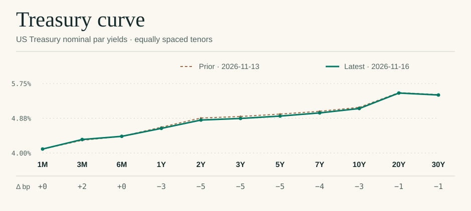

# Market Observatory

**[Open the live dashboard →](https://ankitv25.github.io/Market-Observatory/)**

[Full project plan](docs/PROJECT_PLAN.md) · [Research brief](docs/Market-Observatory-Research.pdf) · [Milestones](https://github.com/ankitv25/Market-Observatory/milestones)

**[Market tape](#market-tape) · [Sector rotation](#sector-rotation) · [Treasury curve](#treasury-curve) · [Research notebook](dashboard/RESEARCH.md) · [Cadence log](CADENCE.md) · [Work log](WORKLOG.md)**

Edition compiled **2026-11-17T09:53:11-05:00** · 62 market instruments · dated observations below. Prices and changes use each instrument’s own feed and session. Percentages use unrounded prices.

## The daily reading

**US equities.** The S&P 500 reached 7,416.59 on 2026-11-16, a move of -145.08 points (-1.92%) against 2026-11-13. Its six-month price change was +0.11% from 2026-05-15.

**Sector participation.** 2 of 11 reporting sector ETFs rose on 2026-11-16. Consumer Staples led at +0.27%; Technology finished at -3.24%.

**Equity style.** On 2026-11-16 large-cap growth (-2.87%) finished 1.81 percentage points behind large-cap value (-1.06%), measured by IWF and IWD.

**Energy.** The Dec 2026 WTI contract closed at $85.72/bbl on 2026-11-16, -2.84 dollars per barrel against its own 2026-11-13 close.

**US rates.** On 2026-11-13 the 2-year par yield was 4.88% and the 10-year was 5.15%. The 2s10s spread stood at +27 bp, changing by +3 bp versus 2026-11-12.

**Macro backdrop.** The latest available MRS observation is 2026-09-30. Its regime is Neutral with a composite score of 0.2535.

## Market tape

| Instrument | Last | Δ units | Δ % | 6 months | Observation |
|---|---:|---:|---:|---:|---|
|**Indices**||||||
|[S&P 500](https://finance.yahoo.com/quote/%5EGSPC/history/) · ^GSPC|7,416.59|-145.08|-1.92%|+0.11%|2026-11-16|
|[Nasdaq Composite](https://finance.yahoo.com/quote/%5EIXIC/history/) · ^IXIC|24,509.76|-626.51|-2.49%|-6.54%|2026-11-16|
|[Nasdaq 100](https://finance.yahoo.com/quote/%5ENDX/history/) · ^NDX|27,197.15|-746.59|-2.67%|-6.62%|2026-11-16|
|[Dow Industrials](https://finance.yahoo.com/quote/%5EDJI/history/) · ^DJI|51,608.17|-739.38|-1.41%|+4.20%|2026-11-16|
|[Russell 2000](https://finance.yahoo.com/quote/%5ERUT/history/) · ^RUT|2,742.94|-47.55|-1.70%|-1.80%|2026-11-16|
|**Sectors**||||||
|[Technology](https://finance.yahoo.com/quote/XLK/history/) · XLK|164.76|-5.52|-3.24%|-6.52%|2026-11-16|
|[Communication Services](https://finance.yahoo.com/quote/XLC/history/) · XLC|106.82|-1.87|-1.72%|-7.98%|2026-11-16|
|[Consumer Discretionary](https://finance.yahoo.com/quote/XLY/history/) · XLY|118.15|-1.83|-1.53%|+1.39%|2026-11-16|
|[Consumer Staples](https://finance.yahoo.com/quote/XLP/history/) · XLP|92.60|+0.25|+0.27%|+9.40%|2026-11-16|
|[Energy](https://finance.yahoo.com/quote/XLE/history/) · XLE|63.69|-1.27|-1.96%|+7.15%|2026-11-16|
|[Financials](https://finance.yahoo.com/quote/XLF/history/) · XLF|58.18|-0.50|-0.85%|+13.86%|2026-11-16|
|[Health Care](https://finance.yahoo.com/quote/XLV/history/) · XLV|187.88|-0.97|-0.51%|+29.48%|2026-11-16|
|[Industrials](https://finance.yahoo.com/quote/XLI/history/) · XLI|165.66|-3.12|-1.85%|-3.35%|2026-11-16|
|[Materials](https://finance.yahoo.com/quote/XLB/history/) · XLB|51.47|-0.76|-1.46%|+2.33%|2026-11-16|
|[Real Estate](https://finance.yahoo.com/quote/XLRE/history/) · XLRE|44.25|-0.12|-0.27%|+2.36%|2026-11-16|
|[Utilities](https://finance.yahoo.com/quote/XLU/history/) · XLU|44.12|+0.08|+0.18%|+0.57%|2026-11-16|
|**Styles**||||||
|[US large cap](https://finance.yahoo.com/quote/SPY/history/) · SPY|739.95|-14.42|-1.91%|+0.11%|2026-11-16|
|[Equal-weight S&P 500](https://finance.yahoo.com/quote/RSP/history/) · RSP|218.93|-2.23|-1.01%|+8.62%|2026-11-16|
|[US large-cap growth](https://finance.yahoo.com/quote/IWF/history/) · IWF|111.59|-3.30|-2.87%|-10.28%|2026-11-16|
|[US large-cap value](https://finance.yahoo.com/quote/IWD/history/) · IWD|260.51|-2.80|-1.06%|+12.20%|2026-11-16|
|[US small cap](https://finance.yahoo.com/quote/IWM/history/) · IWM|272.94|-4.60|-1.66%|-1.68%|2026-11-16|
|[US momentum](https://finance.yahoo.com/quote/MTUM/history/) · MTUM|65.71|-2.27|-3.34%|-11.88%|2026-11-16|
|[US quality](https://finance.yahoo.com/quote/QUAL/history/) · QUAL|55.16|-0.86|-1.54%|+4.84%|2026-11-16|
|**Global**||||||
|[Euro STOXX 50](https://finance.yahoo.com/quote/%5ESTOXX50E/history/) · ^STOXX50E|6,348.35|-38.51|-0.60%|+8.93%|2026-11-16|
|[FTSE 100](https://finance.yahoo.com/quote/%5EFTSE/history/) · ^FTSE|10,881.60|-21.00|-0.19%|+6.73%|2026-11-16|
|[Nikkei 225](https://finance.yahoo.com/quote/%5EN225/history/) · ^N225|58,860.43|-801.59|-1.34%|-4.15%|2026-11-17|
|[Hang Seng](https://finance.yahoo.com/quote/%5EHSI/history/) · ^HSI|23,508.17|-245.67|-1.03%|-9.45%|2026-11-17|
|[Nifty 50](https://finance.yahoo.com/quote/%5ENSEI/history/) · ^NSEI|25,387.40|+96.30|+0.38%|+7.38%|2026-11-17|
|[S&P/TSX Composite](https://finance.yahoo.com/quote/%5EGSPTSE/history/) · ^GSPTSE|35,722.10|-383.80|-1.06%|+5.58%|2026-11-16|
|[All-country equity](https://finance.yahoo.com/quote/ACWI/history/) · ACWI|153.00|-3.10|-1.99%|-0.70%|2026-11-16|
|[Developed ex-US/Canada](https://finance.yahoo.com/quote/EFA/history/) · EFA|102.64|-1.53|-1.47%|+0.90%|2026-11-16|
|[Emerging markets](https://finance.yahoo.com/quote/EEM/history/) · EEM|58.89|-2.03|-3.33%|-9.50%|2026-11-16|
|**Futures**||||||
|[WTI crude](https://finance.yahoo.com/quote/CLZ26.NYM/history/) · CLZ26.NYM|85.72|-2.84|-3.21%|+2.76%|2026-11-16|
|[Brent crude](https://finance.yahoo.com/quote/BZF27.NYM/history/) · BZF27.NYM|92.44|-3.40|-3.55%|+4.01%|2026-11-16|
|[Natural gas](https://finance.yahoo.com/quote/NGZ26.NYM/history/) · NGZ26.NYM|3.12|-0.11|-3.34%|-24.32%|2026-11-16|
|[Gold](https://finance.yahoo.com/quote/GCZ26.CMX/history/) · GCZ26.CMX|3,853.00|-33.30|-0.86%|-17.36%|2026-11-16|
|[Silver](https://finance.yahoo.com/quote/SIZ26.CMX/history/) · SIZ26.CMX|46.86|-2.26|-4.60%|-40.62%|2026-11-16|
|[Copper](https://finance.yahoo.com/quote/HGZ26.CMX/history/) · HGZ26.CMX|6.01|-0.08|-1.36%|-6.80%|2026-11-16|
|[Corn](https://finance.yahoo.com/quote/ZCZ26.CBT/history/) · ZCZ26.CBT|448.75|+3.25|+0.73%|-6.70%|2026-11-16|
|[S&P 500 E-mini](https://finance.yahoo.com/quote/ESZ26.CME/history/) · ESZ26.CME|7,439.00|-144.00|-1.90%|-1.50%|2026-11-16|
|[10Y Treasury note](https://finance.yahoo.com/quote/ZNZ26.CBT/history/) · ZNZ26.CBT|105.44|+0.25|+0.24%|-3.05%|2026-11-16|
|**FX**||||||
|[US Dollar Index](https://finance.yahoo.com/quote/DX-Y.NYB/history/) · DX-Y.NYB|103.5500|+0.1400|+0.14%|+4.31%|2026-11-16|
|[EUR/USD](https://finance.yahoo.com/quote/EURUSD%3DX/history/) · EURUSD=X|1.1025|-0.0025|-0.23%|-5.46%|2026-11-16|
|[USD/JPY](https://finance.yahoo.com/quote/JPY%3DX/history/) · JPY=X|159.7800|-0.0950|-0.06%|+0.88%|2026-11-16|
|[GBP/USD](https://finance.yahoo.com/quote/GBPUSD%3DX/history/) · GBPUSD=X|1.3216|-0.0015|-0.11%|-1.31%|2026-11-16|
|[USD/CHF](https://finance.yahoo.com/quote/CHF%3DX/history/) · CHF=X|0.8391|+0.0032|+0.38%|+7.00%|2026-11-16|
|**Credit**||||||
|[Short Treasuries](https://finance.yahoo.com/quote/SHY/history/) · SHY|81.23|+0.06|+0.07%|-1.01%|2026-11-16|
|[Intermediate Treasuries](https://finance.yahoo.com/quote/IEF/history/) · IEF|90.24|+0.20|+0.22%|-3.50%|2026-11-16|
|[Long Treasuries](https://finance.yahoo.com/quote/TLT/history/) · TLT|79.38|+0.00|+0.00%|-5.12%|2026-11-16|
|[Inflation-linked Treasuries](https://finance.yahoo.com/quote/TIP/history/) · TIP|104.57|-0.04|-0.04%|-5.46%|2026-11-16|
|[Investment-grade credit](https://finance.yahoo.com/quote/LQD/history/) · LQD|102.80|-0.01|-0.01%|-4.69%|2026-11-16|
|[High-yield credit](https://finance.yahoo.com/quote/HYG/history/) · HYG|76.73|-0.21|-0.27%|-3.44%|2026-11-16|
|[Agency mortgages](https://finance.yahoo.com/quote/MBB/history/) · MBB|90.41|+0.05|+0.06%|-3.38%|2026-11-16|
|[Municipal bonds](https://finance.yahoo.com/quote/MUB/history/) · MUB|103.53|-0.05|-0.05%|-2.44%|2026-11-16|
|[EM dollar debt](https://finance.yahoo.com/quote/EMB/history/) · EMB|90.72|-0.41|-0.45%|-4.21%|2026-11-16|
|[Senior loans](https://finance.yahoo.com/quote/BKLN/history/) · BKLN|20.50|-0.02|-0.10%|-0.53%|2026-11-16|
|**Alternatives**||||||
|[Listed real estate](https://finance.yahoo.com/quote/VNQ/history/) · VNQ|96.23|-0.24|-0.25%|+2.47%|2026-11-16|
|[Listed infrastructure](https://finance.yahoo.com/quote/IGF/history/) · IGF|66.68|-0.34|-0.51%|+0.95%|2026-11-16|
|[Managed futures](https://finance.yahoo.com/quote/DBMF/history/) · DBMF|32.14|-0.28|-0.86%|+2.91%|2026-11-16|
|[Physical gold ETF](https://finance.yahoo.com/quote/GLD/history/) · GLD|352.93|-2.52|-0.71%|-15.42%|2026-11-16|
|[Bitcoin](https://finance.yahoo.com/quote/BTC-USD/history/) · BTC-USD|64,855.84|-449.22|-0.69%|-16.99%|2026-11-16|
|[Cboe VIX](https://finance.yahoo.com/quote/%5EVIX/history/) · ^VIX|22.91|+3.61|+18.70%|+24.31%|2026-11-16|

## Sector rotation

## Treasury curve

[US Treasury par yields](https://www.federalreserve.gov/datadownload/Output.aspx?rel=H15&series=bf17364827e38702b42a58cf8eaa3f78&lastobs=300&from=&to=&filetype=csv&label=include&layout=seriescolumn) · 2026-11-13 versus 2026-11-12.

| Maturity | Yield | Δ bp |
|---|---:|---:|
|1M|4.10%|-2|
|3M|4.32%|+0|
|6M|4.42%|+0|
|1Y|4.65%|+0|
|2Y|4.88%|+2|
|3Y|4.92%|+2|
|5Y|4.98%|+3|
|7Y|5.05%|+3|
|10Y|5.15%|+5|
|20Y|5.52%|+4|
|30Y|5.47%|+4|

## Edition record

[Quality and source notes](dashboard/SOURCES.md) · [Archived editions](editions/) · [Refresh runs](https://github.com/ankitv25/Market-Observatory/actions/workflows/refresh.yml) · [Methodology](docs/METHODOLOGY.md)

For interactive charts, filters and source detail, download [the self-contained HTML reader](dashboard/observatory.html) using GitHub’s **Download raw file** button and open it locally. Each refresh run also provides the reader as an artifact.
