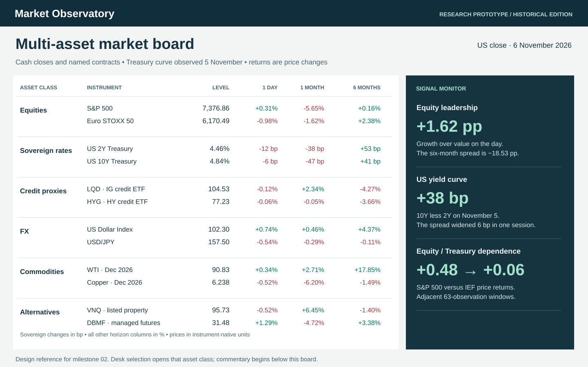

# Market Observatory • Delivery plan

**Product owner objective.** Open a market board, read the six major asset classes without searching, and drill into a desk until the observations, theory, instruments, model assumptions and evidence behind a view are clear. The daily market product takes priority. Company valuation and its existing agent remain a separate project.

[Five-page research brief](Market-Observatory-Research.pdf) · [Readable research specification](MARKET_RESEARCH.md) · [Milestones](https://github.com/ankitv25/Market-Observatory/milestones) · [Work packages](https://github.com/ankitv25/Market-Observatory/issues) · [Financial QA](https://github.com/ankitv25/Market-Observatory/actions/workflows/quality.yml)

## Baseline and research decision

The November 7 review examined a real edition with 62 market instruments, 11 US sector proxies, nine named futures, five portfolio books, nominal Treasury yields and the confirmed MRS. The existing first viewport concentrates on two US indices, oil, VIX and sector rotation. Mid-cap style cells, constituent-level breadth, excess-total-return alpha, real curves, instrument cash flows, OAS, private-market history and vintage-aligned expectations need additional inputs. A level-only screen cannot supply those analytics. The research brief defines the actual analytical deliverables and numerical examples.

**First releasable product.** Six permanent desk rows, per-source freshness, regional sessions and three dated signals. A PM can see equity participation, rates, credit, FX, commodities and alternatives in the first desktop viewport, then enter a desk without using search. Complete desk pages scroll through signal, history, decomposition, economic mechanism, portfolio sensitivity and a thesis record. Every material metric has a definition, benchmark, unit, as-of time, history requirement, source and example of how to interpret it.

## Implementation order

| Milestone | Responsible functions | Dependencies and parallel work | Exit evidence |
|---|---|---|---|
| 01 · Source & release controls | Data steward, quant reviewer, release engineer | Rights inventory, availability registry and release replay can proceed in parallel. Establish a permitted sample for every public data family. | Core source contracts and calendars, replay of starts/ends/rolls, independent arithmetic, immutable serving path and tested rollback. |
| 02 · Multi-asset market board | PM interface lead, cross-asset quant lead | Build against fixtures immediately. Promote public data when milestone 01 gates pass. | Thirty-second blind scan, six visible desks, source access in two interactions, shared horizon semantics, three signals with dates and samples, desktop/tablet/phone evidence. |
| 03 · Asset-class research desks | Equity/factors, rates/credit, real assets/FX | Separate vertical teams can build concurrently after the common contracts. Every desk delivers evidence and its own data-gap matrix. | 3×3 equity coverage, nine fixed-income measures or explicit unavailability, curve/credit tests, comparable FX/futures series, alternatives with real valuation clocks, independently reproduced correlation paths. |
| 04 · Portfolio, thesis & acceptance | Portfolio risk, editorial and release functions | Consume accepted desk measures, dated positions, benchmark history and thesis versions. | Portfolio risk/return reconciliation, archived thesis replay and ten eligible sessions of shadow results with disposition from the council. |

**Cadence of work.** At the start of each work cycle the lead selects a bounded issue and its dependency evidence. A researcher supplies the proposed measure and source basis; a different reviewer builds or checks the expected result before integration. Every merge records actual tests and screenshots against the issue. Weekly, reconcile scope, new data costs, failed checks, source gaps and the next releasable desk in WORKLOG. A milestone closes after its exit evidence exists. Ten eligible market sessions are required for the production trial. Build estimates depend on the vendor pilot and source availability; no paid subscriptions or named external reviewers have been assumed.

## Data and publication contract

1. **Source registry.** For each instrument or macro series record canonical ID, asset desk, venue/calendar, currency, quote convention, benchmark, horizon convention, adjustment basis, release lag, vendor mapping, fallback, permitted audience/derived use/history and correction policy. The public HTML, JSON, archives and Git history are separate publication surfaces to review. All 62 market histories in the sampled edition used Yahoo Finance; the repository has no evidence of a separate public-redistribution grant. [Issue 1](https://github.com/ankitv25/Market-Observatory/issues/1) assigns the existing-publication review to the data steward. The current scheduled publisher continues its prior behavior and has no automated rights gate. Review the existing artifacts and select eligible data or a different distribution arrangement before expanding public history. [Provider information](https://help.yahoo.com/kb/SLN2310.html)
2. **Immutable observations.** Preserve observation, release, retrieval, and build times, source version and checksum where permitted. Each release uses a single edition manifest with quality status and desk coverage. Keep the original publication when a revision arrives. Retained values carry their original dates and reason.
3. **Computation.** Calculate calendar/session anchors, matched returns, risk and attribution once upstream. Export a metric ID and revision to all surfaces. A daily move in a yield is in basis points. A named futures contract uses its own preceding close or explicitly identified settlement. A chart with incomplete history shows its actual endpoints.
4. **Editorial.** A quantitative agent proposes factual claims bound to metric IDs. The editor may present competing mechanisms with counterevidence and next catalyst. An official decision, survey median, market price and house forecast keep distinct authors and horizons. A generated narrative cannot silently change a user thesis. Public research uses public-safe inputs.
5. **Publish.** Stage immutable edition, run quality gates and browser tests, then promote exactly the verified artifact. The current workflow already checks served bytes. Pinning the producing run's actual output and preventing an older overlapping run from promoting are open release tasks. Rehearse last-good recovery. A separate monitor must catch the absence of a scheduled run, which a post-success check alone cannot detect.

**Data rhythm.** Current GitHub refreshes request 11:45 and 23:30 UTC on weekdays. The proposed morning edition reconciles global sessions and events; the closing edition reconciles official prints, dated futures contracts and rates. Refresh event cards after source release and designate the intraday reaction as unavailable when observations cannot bracket the event. Weekly positioning/inventory follows its official release calendar. Monthly MRS/factors and quarterly property/private marks retain their own release vintages. Maintain a per-source grace period and alert only when an expected observation is overdue.

## Agents and independent sign-off

Three agents completed this design review in parallel. They inspected the same public project snapshot independently. The following roles describe work assignments for future cycles, not background processes already running.

| Agent responsibility | Input | Required output and independent reviewer |
|---|---|---|
| Data steward | Source terms, series samples, corporate actions, venue schedule | Signed source/field matrix, retrieval and rights evidence, provisional vs final states. Quant reviewer challenges basis and matches. |
| Desk research | Point-in-time observations, benchmarks, provider methodology | Theory paragraph, unit/example, hypothesis, failure conditions, three contrasting historical cases. PM reviewer tests relevance. |
| Quant validation | Raw permitted inputs and metric specification | Independent expected values, synthetic edge fixtures, failed-case evidence and model/version limits. A model author does not approve their own result. |
| PM and design | Historical editions and desktop/mobile layouts | Blind desk scan, source drilldown, comparison workflow and screenshot evidence. Review outside the implementing UI role. |
| Release and operations | Immutable staged artifact, run ID and prior edition | Browser smoke, source freshness, blob readback, rollback and incident record. Release owner publishes gate dispositions. |

**Council record, November 7.** Coverage reviewer found seven style instruments but no complete size/style grid or total-return factor engine. Reader reviewer found five non-equity subjects buried behind search or subordinate panels and independently reproduced correlations for adjacent 63-session windows. Controls reviewer injected a 999% S&P change and a candidate containing only SPX plus the 11 sectors; the previous verifier accepted both. Independent computations, explicit desk floors and regression cases now reject those mutations. The controls reviewer reran the new gate against both original mutations and confirmed rejection. A follow-up symbol/unit swap led to an additional registry identity test. A finite but incorrectly scaled source yield (484 entered for 4.84) still requires provider-level normalization and source reconciliation in milestone 01. Arithmetic verification does not establish that an upstream level is correct. Design review complete. Production approval remains open.

## Release gates

| Gate | Minimum threshold and failure response | State |
|---|---|---|
| Coverage and arithmetic | Enforce core representatives in each desk, registry group/unit and non-futures ticker identity, 11 sector symbols and required Treasury tenors. Independently recompute last, delta, daily %, six-month anchor and return. Reject inconsistent candidates before publication. | Implemented in edition_quality.py and verify.py; fault-injection CI. |
| Calendars and freshness | Every core row carries venue, age, expected next close and quality state. Test US holiday/Japan open, weekends, DST, futures expiry, revisions and fallback older than the prior edition. Zero silently stale core rows. Missing optional inputs degrade locally. | Open; calendar-age checks in current code are insufficient. |
| Numerical models | Independent known-beta/alpha series, factor residual reconciliation, constant-series correlation, known bond fixture, additive key-rate shocks, portfolio weight/risk reconciliation within reported rounding precision. No causal claim from asynchronous daily prices. | Open; fixtures and endpoints specified in research brief. |
| Correlations | Exact shared start/end observations; one currency/basis; show N and date; compare adjacent non-overlapping windows. Suppress undersampled windows under a declared threshold (proposed 80% minimum), and zero-variance pairs. A portfolio covariance requires a common sample or tested PSD treatment. | Worked example reproduced, production model open. |
| Interface and provenance | At 1440×900 six desks and their daily changes visible before commentary. At 390/768 widths no page-wide overflow; primary six-desk scan needs no search. Accessible text alternatives, keyboard selection, chart/table agreement to displayed precision. | Existing live monitor smoke tested previously. New layout still to be built and tested. |
| Live release | Output SHA, live URL hash and edition identity agree; failed deploy/retry reuses artifact; restore previous edition and expose stale state; check for missed schedules. | Hash readback exists. Pinned publication, persistent browser tests and recovery rehearsal open. |
| Shadow council | Ten eligible sessions. Record core coverage, expected vs actual arrival, stale incidents, numerical corrections, PM scan results and exceptions. Zero fabricated values or silently stale core releases. | Pending milestone 04. |

**Decision rule.** Hard defects in published units, arithmetic, identity, data rights or cross-desk completeness prevent promotion of the affected release. On a delayed optional source, show the latest permissible observation with age and explanation. Record each exception with edition ID, severity, owner, evidence link, remediation and date. The work log tracks project decisions; the cadence ledger tracks actual editions.

**Immediate sequence.** Start source review and the immutable release fixture together. Use the existing edition to prototype the six-desk board, then pass it through the PM scan before spending effort on additional components. The separate equity valuation dashboard becomes a downstream reader of approved sector/industry research.
